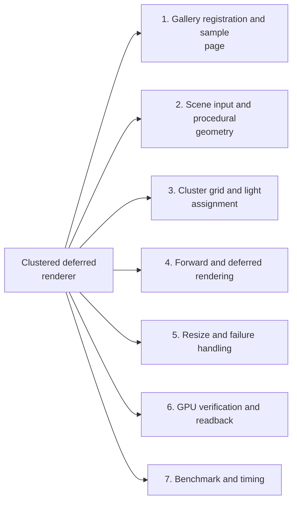
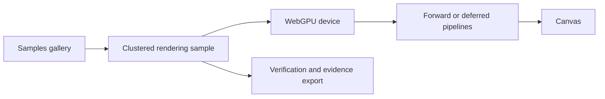
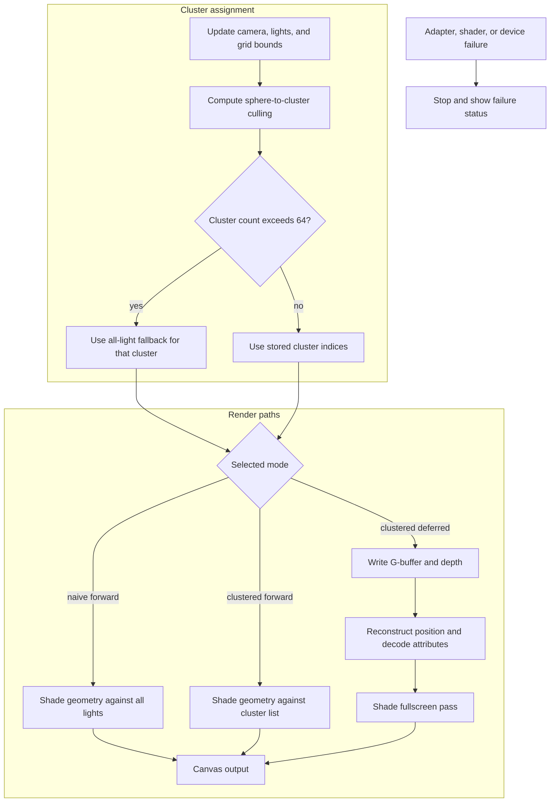

# Clustered deferred renderer

A coursework extension of the complete [official WebGPU Samples](https://github.com/webgpu/webgpu-samples) tree at `e040ec1a20dbbe01afed30c812e825b2639cfe5b`. Original history, samples, author notices, APIs, assets, [BSD-3-Clause license](LICENSE.txt), and [original README](README.upstream.md) are retained. New work is in `sample/clusteredRendering/`; no student skeleton or solution code is used.

## Contents
- [Implementation techniques](#implementation-techniques)

- [Architecture and execution guide](#architecture-and-execution-guide)
- [Run](#run)
- [Added behavior](#added-behavior)
- [Verification and results](#verification-and-results)
- [Dependency and operational limits](#dependency-and-operational-limits)
- [Verification skill](.agents/skills/verify-clustered-renderer/SKILL.md)

## Architecture and execution guide

### Subsystem map

Select a subsystem in the diagram to open its techniques, tradeoffs, and code references. The numbered links provide the same navigation. This map groups components; the execution diagrams show their runtime flow.



1. [Gallery registration and sample page](#subsystem-gallery-registration-and-sample-page)
2. [Scene input and procedural geometry](#subsystem-scene-input-and-procedural-geometry)
3. [Cluster grid and light assignment](#subsystem-cluster-grid-and-light-assignment)
4. [Forward and deferred rendering](#subsystem-forward-and-deferred-rendering)
5. [Resize and failure handling](#subsystem-resize-and-failure-handling)
6. [GPU verification and readback](#subsystem-gpu-verification-and-readback)
7. [Benchmark and timing](#subsystem-benchmark-and-timing)

The extension adds [clustered shading](#clustered-shading) in forward and deferred paths inside the retained WebGPU Samples tree. The inherited camera, gallery, math package, and build system remain the host; the new sample owns procedural boxes, bounded lights, cluster culling, and its verification controls. The inherited deferred sample is a separate all-light path, not part of this extension.

<details>
<summary>Expand flow diagram 1</summary>



</details>

The gallery starts the sample. The browser creates the device and pipelines; frame work runs in WebGPU. Verification and evidence export read results through the sample's explicit controls.

<details>
<summary>Expand flow diagram 2</summary>



</details>

Culling stores at most 64 indices but preserves the full count. The [overflow fallback](#overflow-fallback) loops across all lights, keeping correctness at higher cost. [Deferred shading](#deferred-shading) writes geometry data to a [G-buffer](#gbuffer) first, then reconstructs view position from depth for lighting.

| Subsystem | Responsibility and invariant | Source |
| --- | --- | --- |
| Gallery integration | Registers the sample and owns inherited page bootstrapping. | [`samples.ts`](src/samples.ts), [`main.ts`](src/main.ts) |
| Scene and controls | Builds procedural boxes, updates camera/light settings, and selects one of three paths. | [`main.ts`](sample/clusteredRendering/main.ts), [`math.ts`](sample/clusteredRendering/math.ts) |
| Cluster culling and lighting | Tests light spheres against conservative AABBs, stores 64 indices, and falls back when the count is larger. | [`render.wgsl`](sample/clusteredRendering/render.wgsl) |
| Verification | Checks path outputs and captures browser-side evidence through explicit actions. | [`verify.ts`](sample/clusteredRendering/verify.ts), [`benchmark.ts`](sample/clusteredRendering/benchmark.ts) |
| GPU target creation | Recreates bounded G-buffer and depth resources when viewport dimensions change. | [`main.ts`](sample/clusteredRendering/main.ts) |

The user journey follows these steps:

1. Open the clustered sample from the inherited gallery. The page requests a high-performance WebGPU adapter and device; if either is unavailable, it reports failure and cannot render.
2. The sample updates the camera, procedural lights, and logarithmic cluster bounds. Compute culling writes per-cluster light indices and complete intersection counts.
3. Choose naive forward, clustered forward, or clustered deferred. Forward paths shade geometry directly; deferred writes attributes and depth, then shades a fullscreen pass.
4. If a cluster exceeds capacity, the shader evaluates every light for that cluster. Device loss, shader validation errors, or uncaught errors stop the loop and set a failure status.
5. Use Verify GPU and Export evidence to capture the actual browser path. CPU tests do not establish shader execution.

| Choice | Current implementation and rationale | Alternative and cost or reconsideration point |
| --- | --- | --- |
| Conservative cluster AABBs | Sphere intersection includes lights that can affect a cluster, avoiding dropped lights from tight approximate bounds. | Tighter bounds might reduce lists but cost more geometry or per-frame bound work. |
| Capacity plus all-light fallback | Lists store 64 indices while retaining the true count; overflow triggers full lighting rather than truncation. | Larger fixed lists consume more storage per cluster; dropping excess lights would change the image. |
| Logarithmic depth slices | The grid uses 12×12×16 cells across near/far depth, allocating more slices near the camera. | Uniform slices simplify indexing but may group near geometry less effectively; compare with the same scene and checks. |
| Separate deferred G-buffer paths | Float and packed modes allow storage tradeoffs while reusing deferred lighting. | One representation avoids controls but prevents comparing precision and payload; timestamps are quantized and do not prove small stage differences. |
| Bounded resize targets | Render targets cap at 1200×1200 to bound allocation. | Unbounded viewport targets can allocate more memory; change only with explicit resource and device checks. |

The table gives rationale inferred from implementation, not historical design records. Results cover the owned procedural scene and tested browser/device. Logical texture bytes are not physical peak VRAM; GPU timestamp readings are quantized, and the CPU workflow does not claim GPU verification.

<a id="clustered-shading"></a>

<details><summary>What is clustered shading?</summary>

Clustered shading partitions the view volume into cells and assigns nearby lights to each cell. This sample uses a 12×12×16 grid, so a fragment checks its cell's list instead of every light when that list fits.

</details>

<a id="cluster-aabb"></a>

<details><summary>What is a cluster AABB?</summary>

An axis-aligned bounding box is a box whose sides align with coordinate axes. The culling shader tests each light sphere against a conservative box for one cluster; a sphere intersection adds that light's index.

</details>

<a id="gbuffer"></a>

<details><summary>What is a G-buffer?</summary>

A G-buffer stores geometry attributes such as normal, albedo, and depth for later shading. The deferred sample writes those values, then reconstructs position from depth in a fullscreen lighting pass.

</details>

<a id="deferred-shading"></a>

<details><summary>What is deferred shading?</summary>

Deferred shading separates geometry rendering from lighting. Here geometry fills the G-buffer first, and a fullscreen pass reads its depth and material data to calculate clustered light contributions.

</details>

<a id="octahedral-encoding"></a>

<details><summary>What is octahedral encoding?</summary>

Octahedral encoding maps a unit normal onto two packed signed values. This sample can store the packed normal with packed albedo, reducing the G-buffer representation compared with float attributes.

</details>

<a id="overflow-fallback"></a>

<details><summary>What is the overflow fallback?</summary>

The overflow fallback handles clusters whose full light count exceeds the stored index capacity. Here the shader switches to an all-light loop when the count is above 64, preserving included lights at extra shading cost.

</details>

<a id="run"></a>

## Implementation techniques

This section covers the active local `clusteredRendering` sample, its visible verification and benchmark paths, and its gallery registration. The rationale is inferred from current code.

<details>
<summary>Full technique index</summary>

| Active subsystem | Technique cards | Source files |
| --- | --- | --- |
| Gallery registration and sample page | No separate rendering technique | [`samples.ts`](src/samples.ts), [`main.ts`](src/main.ts), [`meta.ts`](sample/clusteredRendering/meta.ts), [`index.html`](sample/clusteredRendering/index.html) |
| Scene input and procedural geometry | [Seeded light inputs](#technique-p18-seeded-inputs); [procedural box geometry](#technique-p18-procedural-box-geometry) | [`math.ts`](sample/clusteredRendering/math.ts), [`main.ts`](sample/clusteredRendering/main.ts) |
| Cluster grid and light assignment | [Logarithmic conservative grid](#technique-p18-logarithmic-conservative-grid); [serial sphere-to-AABB culling and list construction](#technique-p18-cluster-light-lists); [overflow fallback](#technique-p18-overflow-fallback) | [`math.ts`](sample/clusteredRendering/math.ts), [`render.wgsl`](sample/clusteredRendering/render.wgsl) |
| Forward and deferred rendering | [Ordered render passes](#technique-p18-ordered-render-pass-composition); [diffuse lighting loops](#technique-p18-mode-shared-lighting-loops); [G-buffer representations](#technique-p18-gbuffer-encoding); [depth reconstruction](#technique-p18-position-reconstruction) | [`main.ts`](sample/clusteredRendering/main.ts), [`render.wgsl`](sample/clusteredRendering/render.wgsl) |
| Resize and failure handling | [Capped targets and fail-stop reporting](#technique-p18-bounded-resize-failure-state) | [`main.ts`](sample/clusteredRendering/main.ts) |
| GPU verification and readback | [GPU readback and independent oracles](#technique-p18-readback-oracle) | [`main.ts`](sample/clusteredRendering/main.ts), [`math.ts`](sample/clusteredRendering/math.ts), [`verify.ts`](sample/clusteredRendering/verify.ts) |
| Benchmark and timing | [Correctness-gated optional timing](#technique-p18-correctness-gated-benchmark) | [`main.ts`](sample/clusteredRendering/main.ts), [`benchmark.ts`](sample/clusteredRendering/benchmark.ts) |

</details>

The inherited `deferredRendering` example and external `clusteredShading` link remain separate upstream entries; they are not implementation sources for this sample. See [the inherited-path boundary](#added-behavior).

<a id="subsystem-gallery-registration-and-sample-page"></a>

### 1. Gallery registration and sample page

[Back to the subsystem map](#architecture-and-execution-guide).

**Code.** [`src/samples.ts`](src/samples.ts), [`src/main.ts`](src/main.ts), [`sample/clusteredRendering/meta.ts`](sample/clusteredRendering/meta.ts), [`sample/clusteredRendering/index.html`](sample/clusteredRendering/index.html).

The inherited gallery registry, iframe bootstrap, and sample metadata route to the standalone page; this wiring does not implement a separate rendering method.

<a id="subsystem-scene-input-and-procedural-geometry"></a>

### 2. Scene input and procedural geometry

[Back to the subsystem map](#architecture-and-execution-guide).

**Code.** [`sample/clusteredRendering/math.ts`](sample/clusteredRendering/math.ts), [`sample/clusteredRendering/main.ts`](sample/clusteredRendering/main.ts).

**Techniques.** [Seeded deterministic light inputs](#technique-p18-seeded-inputs), [Procedural expanded-box scene geometry](#technique-p18-procedural-box-geometry).

<a id="technique-p18-seeded-inputs"></a>

<details>
<summary>Seeded deterministic light inputs</summary>

**Mechanism.** `seededLights` restarts a small linear congruential generator at seed `565`, then derives each light's position, radius, and color in array order. A time parameter adds a bounded horizontal offset. `update` converts the resulting positions to view space and packs the values into `Float32Array` inputs before upload.

**Example.** `seededLights(256, 0)` creates the same 256-light test input on each call.

**Why here.** Verification and benchmark runs can compare render paths with matching light values. The renderer can still animate the scene by changing the time argument.

**Tradeoffs.** The fixed seed gives repeatable synthetic inputs, not varied production scenes. Animation only changes the position offset; it does not resample each light.

**Code and ownership.** [`math.ts`](sample/clusteredRendering/math.ts#L10) `seededLights`; [`main.ts`](sample/clusteredRendering/main.ts#L338) `update`; extension.


**Used in.** [Scene input and procedural geometry](#subsystem-scene-input-and-procedural-geometry). [Back to the subsystem map](#architecture-and-execution-guide).

</details>

<a id="technique-p18-procedural-box-geometry"></a>

<details>
<summary>Procedural expanded-box scene geometry</summary>

**Mechanism.** `box` emits two triangles for each of six axis-aligned faces, repeating position, face normal, and albedo for every vertex. `buildGeometry` emits a floor, a wall, and a regular grid of boxes into one flat vertex array, then uploads that array to a vertex buffer.

**Example.** `buildGeometry(5)` emits the room and 25 grid boxes without loading a model or texture.

**Why here.** The renderer controls the scene size and can rebuild the box grid for benchmark workloads.

**Tradeoffs.** Expanded faces duplicate shared vertices and use a larger vertex buffer than indexed geometry. This keeps the generated format direct to draw, but the code is for a small procedural scene.

**Code and ownership.** [`main.ts`](sample/clusteredRendering/main.ts#L217) `box`; [`main.ts`](sample/clusteredRendering/main.ts#L240) `buildGeometry`; extension.


**Used in.** [Scene input and procedural geometry](#subsystem-scene-input-and-procedural-geometry). [Back to the subsystem map](#architecture-and-execution-guide).

</details>

<a id="subsystem-cluster-grid-and-light-assignment"></a>

### 3. Cluster grid and light assignment

[Back to the subsystem map](#architecture-and-execution-guide).

**Code.** [`sample/clusteredRendering/math.ts`](sample/clusteredRendering/math.ts), [`sample/clusteredRendering/render.wgsl`](sample/clusteredRendering/render.wgsl).

**Techniques.** [Logarithmic depth slices with outward-rounded AABBs](#technique-p18-logarithmic-conservative-grid), [Serial sphere-to-AABB culling and bounded light-list construction](#technique-p18-cluster-light-lists), [True-count overflow with all-light fallback](#technique-p18-overflow-fallback).

<a id="technique-p18-logarithmic-conservative-grid"></a>

<details>
<summary>Logarithmic depth slices with outward-rounded AABBs</summary>

**Mechanism.** `clusterBounds` divides the near-to-far range into logarithmic depth slices. For each grid cell it computes the eight frustum corners in view space, takes per-axis minima and maxima, and expands each bound before rounding it to `f32`. `clusterIndex` uses screen tiles for x and y and the matching logarithmic formula for view depth.

**Example.** With near `0.5`, far `80`, and 16 z slices, slice `k` begins at `0.5 × (80 / 0.5)^(k / 16)`.

**Why here.** The culler and fragment shader use the same grid dimensions and depth mapping. Outward rounding keeps the uploaded boxes conservative at float boundaries.

**Tradeoffs.** The fixed grid can group empty or unevenly occupied space. Bounds are rebuilt when the target dimensions change, and the CPU setup evaluates eight corners per cluster.

**Code and ownership.** [`math.ts`](sample/clusteredRendering/math.ts#L28) `clusterBounds`; [`render.wgsl`](sample/clusteredRendering/render.wgsl#L49) `clusterIndex`; extension.


**Used in.** [Cluster grid and light assignment](#subsystem-cluster-grid-and-light-assignment). [Back to the subsystem map](#architecture-and-execution-guide).

</details>

<a id="technique-p18-cluster-light-lists"></a>

<details>
<summary>Serial sphere-to-AABB culling and bounded light-list construction</summary>

**Mechanism.** Each compute invocation handles one cluster and scans the active lights in order. It computes the squared distance from each sphere center to the nearest point on that cluster's AABB. An intersecting sphere appends its index at the current local count, then the invocation increments that count. There is no atomic append; different invocations write different cluster records.

**Example.** When a light center lies outside one AABB axis, the shader adds that axis's gap squared to the sphere-to-box distance test.

**Why here.** A fragment maps its pixel and view depth back to the same cluster. The renderer can then evaluate that cluster's candidate indices instead of scanning all lights in the common case.

**Tradeoffs.** Every cluster invocation scans every active light, so culling work grows with both counts. Each invocation handles one cluster's list serially; the shader does not use subgroup cooperation or atomic compaction.

**Code and ownership.** [`render.wgsl`](sample/clusteredRendering/render.wgsl#L17) `cull`; [`render.wgsl`](sample/clusteredRendering/render.wgsl#L61) `lighting`; extension.


**Used in.** [Cluster grid and light assignment](#subsystem-cluster-grid-and-light-assignment). [Back to the subsystem map](#architecture-and-execution-guide).

</details>

<a id="technique-p18-overflow-fallback"></a>

<details>
<summary>True-count overflow with all-light fallback</summary>

**Mechanism.** Each cluster record reserves 64 indices and stores a separate count. `cull` writes indices only while the local count is below 64, but it increments the count for every intersection. `lighting` uses the full count to detect overflow and scans all active lights for that cluster.

**Example.** A cluster hit by 70 lights stores the first 64 indices and count `70`; its pixels use the all-light loop.

**Why here.** The complete count distinguishes a full list from a truncated one, so overflow does not silently omit lights.

**Tradeoffs.** An overflowing cluster loses clustered pruning for its pixels. Its lighting cost then follows the all-light path.

**Code and ownership.** [`math.ts`](sample/clusteredRendering/math.ts#L2) `CAPACITY`; [`render.wgsl`](sample/clusteredRendering/render.wgsl#L22) `cull`; [`render.wgsl`](sample/clusteredRendering/render.wgsl#L61) `lighting`; extension.


**Used in.** [Cluster grid and light assignment](#subsystem-cluster-grid-and-light-assignment). [Back to the subsystem map](#architecture-and-execution-guide).

</details>

<a id="subsystem-forward-and-deferred-rendering"></a>

### 4. Forward and deferred rendering

[Back to the subsystem map](#architecture-and-execution-guide).

**Code.** [`sample/clusteredRendering/main.ts`](sample/clusteredRendering/main.ts), [`sample/clusteredRendering/render.wgsl`](sample/clusteredRendering/render.wgsl).

**Techniques.** [Ordered compute, geometry, lighting, and presentation passes](#technique-p18-ordered-render-pass-composition), [Naive and clustered diffuse-light loops](#technique-p18-mode-shared-lighting-loops), [Float and packed G-buffer representations](#technique-p18-gbuffer-encoding), [View-position reconstruction from depth](#technique-p18-position-reconstruction).

**Related concepts.** [G-buffer](#gbuffer).

<a id="technique-p18-ordered-render-pass-composition"></a>

<details>
<summary>Ordered compute, geometry, lighting, and presentation passes</summary>

**Mechanism.** `render` records the selected work in one command encoder. Clustered modes dispatch culling first. The geometry pass then shades forward or writes deferred attributes and depth. Deferred mode adds a fullscreen triangle pass, and visible rendering adds a presentation pass before the encoder is submitted.

**Example.** Clustered deferred records culling, G-buffer geometry, fullscreen lighting, and presentation in that order.

**Why here.** The modes share the same device buffers, scene, light inputs, and command submission while selecting different geometry and lighting passes.

**Tradeoffs.** The deferred path adds attachments and a fullscreen pass. Naive forward skips culling and evaluates lights directly, while clustered forward still shades geometry in one pass.

**Code and ownership.** [`main.ts`](sample/clusteredRendering/main.ts#L377) `render`; [`main.ts`](sample/clusteredRendering/main.ts#L766) `frame`; extension.


**Used in.** [Forward and deferred rendering](#subsystem-forward-and-deferred-rendering). [Back to the subsystem map](#architecture-and-execution-guide).

</details>

<a id="technique-p18-mode-shared-lighting-loops"></a>

<details>
<summary>Naive and clustered diffuse-light loops</summary>

**Mechanism.** `contribution` computes a Lambert diffuse dot product and squared linear distance falloff for one light. `lighting` uses an all-light loop for naive forward and overflowed clusters; otherwise it loops over the cluster's stored indices. The forward fragment and deferred fragment call the same lighting function.

**Example.** An in-range light adds `color × max(dot(normal, direction), 0) × attenuation²` to the material's diffuse illumination.

**Why here.** Sharing the contribution and output transform makes the render modes comparable while allowing the candidate-light loop to change.

**Tradeoffs.** The shader models diffuse Lambert lighting, not a physically based BRDF: it has no specular, roughness, or metalness terms. The all-light loop costs more fragment work when used.

**Code and ownership.** [`render.wgsl`](sample/clusteredRendering/render.wgsl#L54) `contribution`; [`render.wgsl`](sample/clusteredRendering/render.wgsl#L61) `lighting`; [`render.wgsl`](sample/clusteredRendering/render.wgsl#L74) `forward`; [`render.wgsl`](sample/clusteredRendering/render.wgsl#L108) `deferred`; extension.


**Used in.** [Forward and deferred rendering](#subsystem-forward-and-deferred-rendering). [Back to the subsystem map](#architecture-and-execution-guide).

</details>

<a id="technique-p18-gbuffer-encoding"></a>

<details>
<summary>G-buffer alternatives and octahedral normal packing</summary>

**Mechanism.** Float mode writes view-space normals and albedo to `rgba16float` and `rgba8unorm` attachments. Packed mode maps each normalized normal onto an octahedron, folds the lower hemisphere, quantizes two signed normalized coordinates into one word, and packs albedo into a second word. The deferred pass selects the matching decode path. Both modes retain the shared depth attachment.

**Example.** Packed output uses `vec2u(encodeOct(normal), pack4x8unorm(albedo))` in an `rg32uint` target.

**Why here.** The sample can compare float and packed G-buffer representations while reusing its geometry and deferred-lighting passes.

**Tradeoffs.** Packing reduces attachment payload but quantizes normals and albedo. Float mode uses more attachment data and avoids this encoding loss.

**Code and ownership.** [`render.wgsl`](sample/clusteredRendering/render.wgsl#L78) `encodeOct`; [`render.wgsl`](sample/clusteredRendering/render.wgsl#L84) `decodeOct`; [`render.wgsl`](sample/clusteredRendering/render.wgsl#L91) `gbufferFloat`; [`render.wgsl`](sample/clusteredRendering/render.wgsl#L97) `gbufferPacked`; [`main.ts`](sample/clusteredRendering/main.ts#L280) `resources`; extension.


**Used in.** [Forward and deferred rendering](#subsystem-forward-and-deferred-rendering). [Back to the subsystem map](#architecture-and-execution-guide).

</details>

<a id="technique-p18-position-reconstruction"></a>

<details>
<summary>View-position reconstruction from depth</summary>

**Mechanism.** The fullscreen deferred pass loads the pixel's depth, maps pixel coordinates and depth to clip space, multiplies by the inverse projection matrix, then divides xyz by homogeneous `w`. The resulting view-space position drives cluster selection and light attenuation.

**Example.** `homogeneous = inverseProjection * vec4f(ndc, depth, 1)` followed by `homogeneous.xyz / homogeneous.w`.

**Why here.** The G-buffer stores depth through the depth attachment instead of writing a separate position texture.

**Tradeoffs.** Reconstruction depends on matching the projection, viewport and depth conventions used by geometry. A position attachment would use more storage but avoid this reconstruction math.

**Code and ownership.** [`render.wgsl`](sample/clusteredRendering/render.wgsl#L100) `fullscreen`; [`render.wgsl`](sample/clusteredRendering/render.wgsl#L108) `deferred`; extension.


**Used in.** [Forward and deferred rendering](#subsystem-forward-and-deferred-rendering). [Back to the subsystem map](#architecture-and-execution-guide).

</details>

<a id="subsystem-resize-and-failure-handling"></a>

### 5. Resize and failure handling

[Back to the subsystem map](#architecture-and-execution-guide).

**Code.** [`sample/clusteredRendering/main.ts`](sample/clusteredRendering/main.ts).

**Techniques.** [Capped resize resources with fail-stop error reporting](#technique-p18-bounded-resize-failure-state).

**Related concepts.** [G-buffer](#gbuffer).

<a id="technique-p18-bounded-resize-failure-state"></a>

<details>
<summary>Capped resize resources with fail-stop error reporting</summary>

**Mechanism.** `resources` converts the canvas's CSS size and device-pixel ratio to dimensions capped at 1200 per axis. On a size or packing-mode change it destroys old textures, recreates the targets, and uses 1×1 placeholders for inactive G-buffer bindings. Adapter absence, device loss, uncaptured validation errors, and window errors set a failure status and stop the frame loop.

**Example.** At device-pixel ratio 1, a 1600 CSS-pixel canvas dimension requests a 1200-pixel target. The status records a lost device as `FAIL: Device lost: ...`.

**Why here.** Resizing and packed-mode changes need matching textures and bind groups, and a failed WebGPU device cannot render the frame.

**Tradeoffs.** The cap bounds requested texture dimensions, not physical driver allocation. Fail-stop reporting leaves no automatic device recovery path.

**Code and ownership.** [`main.ts`](sample/clusteredRendering/main.ts#L35) `fail`; [`main.ts`](sample/clusteredRendering/main.ts#L43) adapter/device setup; [`main.ts`](sample/clusteredRendering/main.ts#L280) `resources`; extension.


**Used in.** [Resize and failure handling](#subsystem-resize-and-failure-handling). [Back to the subsystem map](#architecture-and-execution-guide).

</details>

<a id="subsystem-gpu-verification-and-readback"></a>

### 6. GPU verification and readback

[Back to the subsystem map](#architecture-and-execution-guide).

**Code.** [`sample/clusteredRendering/main.ts`](sample/clusteredRendering/main.ts), [`sample/clusteredRendering/math.ts`](sample/clusteredRendering/math.ts), [`sample/clusteredRendering/render.wgsl`](sample/clusteredRendering/render.wgsl), [`sample/clusteredRendering/verify.ts`](sample/clusteredRendering/verify.ts), [`sample/clusteredRendering/math.test.mjs`](sample/clusteredRendering/math.test.mjs).

**Techniques.** [GPU readback against independent CPU and image oracles](#technique-p18-readback-oracle).

<a id="technique-p18-readback-oracle"></a>

<details>
<summary>GPU readback against independent CPU and image oracles</summary>

**Mechanism.** Verification copies cluster buffers and rendered pixels into map-readable buffers. Image copies use the WebGPU row-pitch alignment and strip padding after mapping. `clusterMembers` independently tests the uploaded `f32` light values against regenerated canonical bounds; image checks compare naive, clustered, float-deferred, and packed-deferred outputs within explicit channel tolerances.

**Example.** The dense-overflow case requires a nonzero overflow-cluster count, exact full-count and stored-index agreement, and deferred images within their configured tolerances.

**Why here.** A CPU predicate and a naive render path provide checks independent of the GPU culling and clustered lighting branches.

**Tradeoffs.** Mapping buffers waits for GPU work and is intended for explicit verification. It does not provide a CPU rendering fallback or a timing result.

**Code and ownership.** [`main.ts`](sample/clusteredRendering/main.ts#L569) `readBuffer`; [`main.ts`](sample/clusteredRendering/main.ts#L584) `readImage`; [`math.ts`](sample/clusteredRendering/math.ts#L71) `clusterMembers`; [`verify.ts`](sample/clusteredRendering/verify.ts#L34) `imageError`; [`verify.ts`](sample/clusteredRendering/verify.ts#L67) `runVerification`; extension.


**Used in.** [GPU verification and readback](#subsystem-gpu-verification-and-readback). [Back to the subsystem map](#architecture-and-execution-guide).

</details>

<a id="subsystem-benchmark-and-timing"></a>

### 7. Benchmark and timing

[Back to the subsystem map](#architecture-and-execution-guide).

**Code.** [`sample/clusteredRendering/main.ts`](sample/clusteredRendering/main.ts), [`sample/clusteredRendering/benchmark.ts`](sample/clusteredRendering/benchmark.ts), [`sample/clusteredRendering/verify.ts`](sample/clusteredRendering/verify.ts).

**Techniques.** [Correctness-gated interleaved timing with optional GPU timestamps](#technique-p18-correctness-gated-benchmark).

<a id="technique-p18-correctness-gated-benchmark"></a>

<details>
<summary>Correctness-gated interleaved timing with optional GPU timestamps</summary>

**Mechanism.** Benchmark workloads compare the four render modes before timing. Each side gets ten warmup frames, then seven repeats of twenty frames in rotated order. Every repeat ends with an exact image comparison to its checked baseline. The driver records queue-completion wall time and adds pass timestamps only when the adapter exposes `timestamp-query`.

**Example.** Without timestamp-query support, `gpuMs` and stage timing fields remain `null`; the benchmark can still retain host wall-time samples.

**Why here.** Correctness gates make the timed outputs comparable, and rotating side order avoids always timing one mode first.

**Tradeoffs.** Timestamp spans are optional and device/browser timing resolution limits small comparisons. Wall time includes render submission and queue completion, while neither measure proves a speedup outside the recorded workload.

**Code and ownership.** [`benchmark.ts`](sample/clusteredRendering/benchmark.ts#L36) `distribution`; [`benchmark.ts`](sample/clusteredRendering/benchmark.ts#L48) `runBenchmark`; [`main.ts`](sample/clusteredRendering/main.ts#L464) `benchmark`; [`main.ts`](sample/clusteredRendering/main.ts#L497) measurement callback; extension.


**Used in.** [Benchmark and timing](#subsystem-benchmark-and-timing). [Back to the subsystem map](#architecture-and-execution-guide).

</details>

## Run

Use Node 24 and the existing npm lockfile:

```sh
npm ci --ignore-scripts
npm run lint
npm run test:clustered
npm run typecheck
npm run build
node node_modules/servez/bin/servez --port 8088 --local --no-scan out
```

Open `http://localhost:8088/sample/clusteredRendering/` in a WebGPU-capable browser. The gallery also lists the new sample. Choose Naive forward, Clustered forward, or Clustered deferred in dat.GUI. Set light count (0–1024), freeze light motion, orbit the camera, and switch packed normals. Resize recreates bounded render targets (maximum 1200×1200). Adapter, device-loss, shader, and validation failures are displayed; there is no CPU rendering substitute.

On the development Windows host use `C:/Users/steve/.cache/codex-runtimes/codex-primary-runtime/dependencies/node/bin/node.exe` and `C:/nvm4w/nodejs/node_modules/npm/bin/npm-cli.js` explicitly; the default npm shim selects Node 25. The production build now invokes Rollup through `process.execPath` instead of a Unix shell path, fixing the reproduced Windows build failure. `npm start` retains the original upstream development watcher. Deployment is disabled; the added CI job has read-only permissions and runs static/CPU checks, with GPU verification explicitly local.

## Added behavior

The new scene is generated from boxes in code, without external model or texture assets. All three paths use the same vertices, camera, diffuse lighting, bounded light spheres, and output transfer curve. Naive forward evaluates every light per fragment. Clustered forward first dispatches compute culling against a 12×12×16 logarithmic view-space grid; each cluster owns its light indices. Clustered deferred writes a G-buffer, then reconstructs view position from depth and applies cluster lighting in a separate fullscreen pass. Every sphere intersecting a conservative cluster AABB is included. Each list stores 64 indices and the full intersection count; an overflowing cluster evaluates all lights instead of silently dropping them.

The official inherited `deferredRendering` sample already provides its own normal/albedo/depth G-buffer, per-pixel all-light deferred shading, depth position reconstruction, and compute light motion. Those are upstream features, not contributions of this extension. The inherited `clusteredShading` entry is an external demo link; the new sample is local and independently verifiable. Light motion in the new sample uses deterministic CPU input updates; culling and rendering execute on the GPU.

## Research extension and measurement

Grid bounds are canonical outward-rounded Float32 inputs built once per resize/projection; all light membership and list construction remain in compute. This avoids divergent CPU/GPU transcendental rounding at near-tangent sphere boundaries. Independent CPU predicates consume the same packed grid/light inputs; a separate test proves that all mathematical and uploaded-projection frustum corners lie within their AABBs. Five CPU tests now include that coverage and the observed light383/cluster1638 regression.

[Cigolle et al., 2014, *A Survey of Efficient Representations for Independent Unit Vectors*](https://jcgt.org/published/0003/02/01/paper-lowres.pdf) motivates octahedral normals: L1 projection, lower-hemisphere fold, signed normalized quantization, then unfold and normalize. The implementation uses a sign-not-zero function at fold boundaries, `pack2x16snorm`, and `unpack2x16snorm`. A packed `rg32uint` target holds one normal word and one `pack4x8unorm` albedo word. The comparison path uses `rgba16float` normal plus `rgba8unorm` albedo. Both share `depth32float` and reconstruct position; neither stores a position target.

For W×H pixels, created G-buffer logical payload is `12WH + 8` bytes unpacked versus `8WH + 12` bytes packed, including inactive 1×1 binding placeholders. Savings are `4WH - 4` bytes (approximately one third); shared depth/output add `8WH` bytes. These are exact texel payload calculations for the created textures, **not a physical driver-allocation measurement**. WebGPU does not expose physical image allocation. The measured packed/float timing ranges below overlap, so memory savings do not establish a packing speedup.

The coursework requirements are [CIS5650 Fall 2025 Project 4](https://github.com/CIS5650-Fall-2025/Project4-WebGPU-Forward-Plus-and-Clustered-Deferred/blob/main/INSTRUCTIONS.md). The clustering reference is [Olsson et al., 2012, *Clustered Deferred and Forward Shading*](https://www.highperformancegraphics.org/previous/www_2012/media/Papers/HPG2012_Papers_Olsson.pdf). These are algorithm/requirements references; no third-party solution implementation is copied.

## Verification and results

The maintained [verification skill](.agents/skills/verify-clustered-renderer/SKILL.md) and [feature map](.agents/skills/verify-clustered-renderer/features/README.md) specify Launch, Doctor, Drive, Evidence, Cleanup. Use visible **Verify GPU**, inspect PASS/FAIL, then **Export evidence** to download JSON. The real GPU driver is [verify.ts](sample/clusteredRendering/verify.ts); no hidden page API is required. It maps compute lists and render images, independently checks CPU sphere/AABB membership and count, compares all three rendering paths and both G-buffers at the same camera/lights, tests zero/maximum/dense-overflow/orbit/depth-boundary scenarios, and executes 4102 GPU octahedral round trips. Pixel tolerances are 1 byte for naive/clustered forward, 3 for naive/unpacked deferred, and 2 for unpacked/packed deferred; octahedral angular tolerance is 0.01 degree. Export includes observed errors and all case flags.

Current evidence: five CPU tests, new-sample typecheck, and full repository lint pass; full build succeeds with inherited TypeScript warnings. Actual visible CUA GPU runs pass at 600×600 desktop and 390×600 narrow canvas sizes on Intel xe-lpg. All six scenarios have zero exact cluster membership mismatches; image errors are at most1 byte; 4102 GPU octahedral samples have maximum angular error 0.0034424956° below 0.01°. Seeded/dense lighting responds materially against zero-light images, so mode agreement is not vacuous. See [reviewed GPU proof and screenshots](docs/evidence/README.md). Native mode chooser and packed toggle were exercised; narrow 390×844 viewport has reachable controls and scrollWidth 390. The verification tab was closed and port 8088 has no listener; evidence survived cleanup. `npm run typecheck` is deliberately scoped to the added sample: whole-tree `tsc -p sample/tsconfig.json --noEmit` still fails pre-existing typed-array upload mismatches and packedIntegerDotProduct errors, without global suppression. Successful scoped CI must not be read as a clean whole-tree typecheck.

## Frozen browser benchmark

The visible in-app-browser campaign on 22 October 2026 passed **Verify GPU**, then **Benchmark**, and exported both real JSON receipts before the owned tab and server were closed. Chrome 155 selected Intel `xe-lpg`; these are integrated-GPU results, not RTX 5080 measurements. Ten warm frames per side preceded seven rotated repetitions of twenty frames at each fixed camera/light/geometry case. The campaign timed 3,360 frames and checked an image after each twenty-frame repeat, for 168 exact repeat-end image comparisons. The initial cross-path comparisons also passed the existing 1/3/2-byte tolerances.

Each cell is **wall p50 / GPU timestamp p50**, milliseconds over 140 submitted frames. Wall time includes production rendering, presentation and queue completion without RAF/vsync pacing; GPU timestamps span that submitted work. All paths render the same image quality and workload.

| Resolution, triangles, lights | Naive forward | Clustered forward | Float deferred | Packed deferred |
| --- | --- | --- | --- | --- |
| 640×360, 324, 64 | 3.60 / 0.918 | 2.60 / 0.262 | 2.50 / 0.262 | 2.50 / 0.197 |
| 640×360, 324, 256 | 5.10 / 3.211 | 3.90 / 1.311 | 3.00 / 0.590 | 3.50 / 0.590 |
| 640×360, 324, 1024 | 16.00 / 13.566 | 14.00 / 11.534 | 6.90 / 4.653 | 7.00 / 4.653 |
| 1280×720, 324, 256 | 16.10 / 13.435 | 6.80 / 4.194 | 3.90 / 1.966 | 4.00 / 1.901 |
| 1280×720, 7524, 256 | 26.90 / 23.724 | 15.20 / 12.386 | 4.00 / 2.228 | 4.00 / 2.097 |
| 1280×720, 7524, 1024 | 97.10 / 92.733 | 87.70 / 84.017 | 20.60 / 17.826 | 20.70 / 17.760 |

[All 24 curated rows](docs/evidence/benchmark/metrics-summary.json) retain raw frame samples, frame p95/ranges, all seven repeat p50 values and their ranges, image checks, logical resources, stage diagnostics, source snapshot and raw receipt hashes. In the largest case, repeat wall p50 ranges are 96.3–99.1 ms naive, 87.1–89.7 clustered forward, 20.0–22.3 float deferred and 20.3–23.0 packed deferred. Deferred shading has a clear advantage over forward paths in that case; packed/float ranges overlap. GPU timestamps are quantized in observed 0.065536 ms steps, so small and zero stage intervals cannot establish fine differences. The final large-case stage diagnostic puts most deferred work in lighting; it is one diagnostic frame, not a counter profile or another timing distribution.

At 720p the created texture payload is 18,432,008 bytes float versus 14,745,612 packed, plus 812,592 geometry bytes and 705,776 other buffer bytes for the larger geometry. These are logical payloads, not measured physical peak VRAM. Results cover owned procedural boxes and bounded lights on one browser/device. Source identity is an unchanged working-tree snapshot after capture; the browser export itself did not embed a source hash. Reproduce with visible Verify GPU → Export evidence → Benchmark → Export evidence, keeping the tab visible, then run `python tools/summarize-benchmark.py <benchmark.json> <verification.json>` to validate/curate retained receipts. Do not overlap benchmarks with other GPU work or builds.

## Dependency and operational limits

Compatible locked dependency updates and removal of unused `rollup-plugin-copy` reduced the observed npm audit count from 20 to 4 packages (1 moderate, 3 high). The remaining `servez-lib → selfsigned → node-forge` advisory has no fixed registry release as inspected; it concerns certificate signature verification. The documented local verification server uses loopback HTTP and does not enable self-signed HTTPS. Showdown has unfixed parsing/XSS advisories; its inherited use converts trusted repository-owned sample descriptions, with no new user HTML input. Do not expand these trust boundaries without addressing their advisories. See [dependency notes](.agents/dependency-notes.md).

The complete local verification lifecycle and independent source/GPU review are recorded in the [verification skill](.agents/skills/verify-clustered-renderer/SKILL.md). Device-loss handling was reviewed but loss was not injected; other GPUs and remote CI have not been run. The original build/deployment workflow bytes are [archived outside the executable workflow directory](docs/upstream-workflows/README.md); the sole active workflow is read-only, uses source-verified pinned current official checkout/setup-node actions, and supports manual dispatch. The project retains the upstream gallery and all examples, including their individual platform/experimental-feature requirements. No cloud deployment or external credentials are required.
